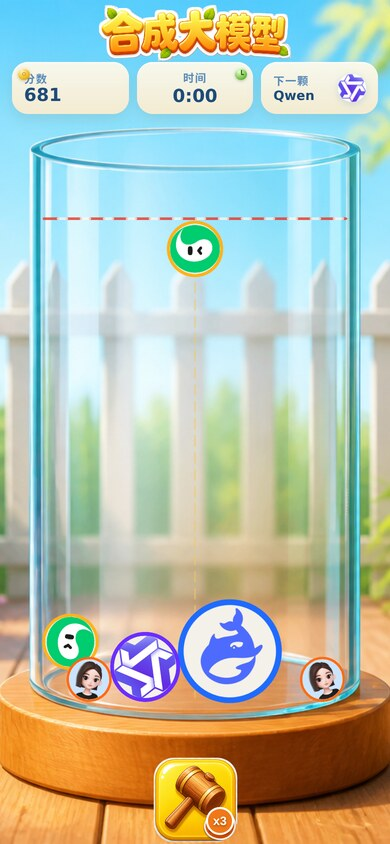
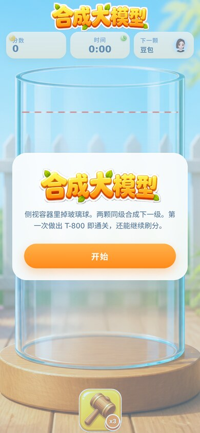

# 训练大模型

[](https://github.com/tyler4400/merge-models/actions/workflows/deploy.yml)

侧视容器里往下掉玻璃球，两颗同级合成下一级。第一次做出 **T-800** 即通关，之后可以继续刷分。休闲局，不是刷分肝游。

> 训练大模型，同级的会练成下一代。看你能不能练出统一全世界的大模型。

<p align="center">
  
  
</p>

完整玩法见 [docs/BRIEF.md](docs/BRIEF.md)。图标出处见 [docs/ASSET_SOURCES.md](docs/ASSET_SOURCES.md)。

## 这是什么仓库

这是一个 **Godogen 薄仓库（thin repo）**：先用 Godogen 的 publish.sh 写入运行时清单和引擎指南，再由宿主 agent 在仓库里把游戏本身搭出来。

源仓库：`/workspace/godogen-src`

发布命令（只做一次，不要 --force 以免清掉游戏文件）：

```
/workspace/godogen-src/publish.sh --engine babylon --agent codex --out /workspace/merge-models
mkdir -p .cursor/skills
cp -R .agents/skills/asset-gen .cursor/skills/asset-gen
```

发布后仓库里自带：

| 文件 | 作用 |
|---|---|
| `AGENTS.md` | Codex 运行时清单（怎么判断进度、资产怎么生成） |
| `babylon.md` | Babylon.js 引擎指南（Vite、Havok wasm、侧效 import、截图） |
| `.agents/skills/asset-gen` | Codex 资产技能 |
| `.cursor/skills/asset-gen` | 同一技能的 Cursor 副本，方便本机宿主用 |

游戏代码、Vite 脚手架、图标、简报都是发布之后写进去的，不是 Godogen 自带的。

## 和官方 Godogen 的差异

| 点 | 官方 Godogen | 本仓库 |
|---|---|---|
| 宿主 | Claude Code 或 Codex CLI | Cursor 宿主（skills 同步到 `.cursor/skills`） |
| 付费资产 | asset-gen（Gemini / Grok / Tripo3D），先问再花 | **不用付费资产生成**。十个官方图标已经收集好了 |
| 端口 | 指南里写 5173 | **5175**（避开其他 Vite） |
| gitignore | 默认忽略 AGENTS.md / babylon.md / .agents（可再发布） | 工程化仓库，这些文件入库，方便阅读 |
| 证明方式 | 无人值守时录 15-20s 视频 | 可玩页面 + 风格确认截图 screenshots/ui-play.png |

## 怎么跑

需要 Node 22+。在仓库根目录安装依赖后执行开发服务器（脚本名 dev）。

打开 **http://127.0.0.1:5175**。`vite.config.ts` 绑定 `host: true`、`port: 5175`、`allowedHosts: true`。

`build` 脚本跑 tsc + vite，只当编译门禁，不是「能玩」的证明。

Havok 直接用 `await HavokPhysics()` 初始化。Vite 根据包内的 `new URL` 将 wasm 输出为 `dist/assets/HavokPhysics-<hash>.wasm`，内容变化会更新 URL，因此适用 `/assets/*` 的一年 immutable 缓存。开发模式通过 `optimizeDeps.exclude` 排除 `@babylonjs/havok`：预打包会把依赖移到 `node_modules/.vite/deps` 并改变 `import.meta.url`，导致 wasm 相对路径失效；排除后从包原位置加载。

## 怎么玩

1. 标题页点「开始」。
2. 左右移动手持球，松手 / 点击 / 空格投放。只能投 1-4 级。可快速连点，不必等上一颗停稳。
3. 两颗同级碰到变成下一级，中央 toast 显示名字。
4. 第一次做出 T-800 即通关结算。可选「继续刷分」或「再来一局」。
5. 堆住的球顶越过警戒线约 2 秒即失败。刚落下 0.8 秒内、以及还在下落穿过红线的，不亮警告。
6. 点底栏锤子，再点一颗已落地的球砸碎（全局限 3 次）。点空处取消；点到还不能砸的球继续瞄准。

桌面：A / D 或方向键或鼠标移动；点击 / 空格投放；S 模拟摇晃（强度 0.8，共用两秒冷却）。
手机：手指拖动手持球，松手投放。画布禁止滚动和缩放。
点击后在点击处的 X 下落；倾斜手机可改变缸内重力方向，最大约 45°，重力大小保持 24。
用力往返晃手机可让缸里已投放的球随机向上弹起，仅对局和锤子瞄准阶段有效。

音频在第一次手势时解锁。

## 源码地图

```
src/
  main.ts                 启动：canvas、Engine、进 createApp
  app/createApp.ts        建场景、开 Havok、挂 Game 与 HUD
  game/
    Game.ts               阶段机：title / playing / won / dead / hammerAim
    constants.ts          容器尺寸、警戒线、锤子数、静止阈值
    tilt.ts               倾斜重力、手机权限与运动事件订阅
    shake.ts              纯逻辑摇晃检测、高通回退与薄浏览器适配
    tiers.ts              10 级：id、中文名、半径、质量、图标
    scoring.ts            10*n*n、连击 1.25、首杀 T-800 +3000 + 时间奖励、双 T-800 +5000
    spawn.ts              下一颗队列，仅 1-4 级，权重 35/30/20/15
    physics.ts            Havok 隐形盒墙；罐子是关卡贴图
    merge.ts              同级接触 → 下一级上弹；两颗 T-800 消失
    hammer.ts             3 把锤子：瞄准 → 点已落地的球 → 碎裂 VFX
    failLine.ts           堆住靠近变红 + 警报；越线约 2s 失败
    TokenLayer.ts         2D 圆片层：图标铺满 + 分阶色圈，叠在院子图上
  ui/                     HTML/CSS 覆盖层：分数、计时、下一颗、锤子、toast、胜负
  audio/Sfx.ts            Web Audio 程序音：碰撞、合成、碎裂、警报、胜利
  assets/icons/           01-doubao.webp … 10-t800.webp
  assets/tokens/          01.webp … 10.webp（游戏圆片）
  assets/levels/          01-courtyard.webp（院子+画上的玻璃缸）
  assets/ui/              title.webp（立体字+图标圆片）、hammer.webp（玩具锤，×3 不烤进图）
```

玩法细则只放在 `docs/BRIEF.md`，避免和代码各说各话。

## 资源表

| 游戏内 | 文件 | 来源 |
|---|---|---|
| 1 豆包 | `src/assets/icons/01-doubao.webp` | 豆包官网 apple-touch |
| 2 元宝 | `src/assets/icons/02-yuanbao.webp` | 腾讯元宝标（LobeHub SVG 转 512） |
| 3 Qwen | `src/assets/icons/03-qwen.webp` | 通义官方 lockup 裁切 |
| 4 Kimi | `src/assets/icons/04-kimi.webp` | Moonshot 官方 Branding Guide 圆形图标 |
| 5 DeepSeek | `src/assets/icons/05-deepseek.webp` | Wikimedia DeepSeek-icon.svg |
| 6 Gemini | `src/assets/icons/06-gemini.webp` | Wikimedia Google Gemini icon 2025 |
| 7 Grok | `src/assets/icons/07-grok.webp` | xAI 官方 brand-kit logomark |
| 8 ChatGPT | `src/assets/icons/08-chatgpt.webp` | Wikimedia ChatGPT-Logo.svg |
| 9 Claude | `src/assets/icons/09-claude.webp` | Wikimedia Claude AI symbol |
| 10 T-800 | `src/assets/icons/10-t800.webp` | 端头像（ICON HEAD），不是博物馆老照片 |
| 出处全文 | `docs/ASSET_SOURCES.md` | 从 merge-assets/SOURCES.md 拷来 |

T-800 的 `10-t800.webp` 由 merge-assets 的端头像 PNG 转换而来。不要用 Tekniska museet 那张旧静物照。

演示 / 编辑用途。商标仍归各权利人。

## 移动端

- index.html：viewport-fit=cover，禁止用户缩放。
- canvas：touch-action none，overscroll-behavior none。
- HUD 按 390px 宽排：顶栏分数 / 时间 / 下一颗，底栏一把玩具锤 ×3。
- 锤子按钮足够大，方便拇指。
- 覆盖层用大号按钮和对比度足够的字。

## 视觉

日光院子，不是夜间霓虹。白 / 米色圆角条、气泡立体字、软阴影。禁止厚黑描边和深色硬框。罐子是淡 U 玻璃缸（木底座、没有盖）。球是 2D 圆片：图标铺满，外圈分阶色；预览球半透明。标题「训练大模型」（立体字 + 图标圆片，无树叶）。

截图：`docs/shots/play.jpg`、`docs/shots/title.jpg`。

## 现状

倾斜已改为真实重力向量 `(24·sinθ, -24·cosθ, 0)`。优先使用运动事件的屏幕平面重力，支持四种屏幕方向及旧版 `window.orientation`；通用 Accelerometer 和姿态事件作为回退。近平放保持目标角，3° 死区、0.1 秒平滑；无传感器时倾角为零。保留 iOS 手势申请权限及 300ms 超时、Android 构造时监听。

删除每帧横向叠加力，改为角度变化超过 1.5° 或持续倾斜每 0.5 秒施加极小向下冲量唤醒。球/墙摩擦均为 0.4，弹性及阻尼不变。倾角达到 15° 时失败等待从 2 秒延长为 4 秒；回到小倾角后按原阈值判断已有计时。`TiltSensor.freeze(sec)` 冻结目标更新；失败检测支持 `paused`（暂停增长和失败触发，仍可警告、线下清零），现已用于摇晃保护，并与倾斜的等待倍数合并。所有倾斜参数见 `src/game/constants.ts` 的 `TILT`。

摇晃已实现：`ShakeDetector` 无 DOM 依赖，优先使用 `acceleration`；缺失或无效时使用含重力数据的一阶高通（0.1 秒）。500ms 内至少 3 个超过 17m/s² 的峰，且 x/y 主轴至少反转 2 次才触发；持续超阈值的同向波瓣不重复计峰，换轴不当作反转。窗口最大加速度在 17–35m/s² 间映射为 0–1 强度，冷却 2 秒。通过 `TiltSensor.subscribeMotion` 复用运动监听与 iOS 手势权限，不新增权限请求；首峰先冻结倾斜目标 0.8 秒，触发时再次冻结。

仅 `playing` / `hammerAim` 生效：已投放、有刚体、非合成中且非手持的球受到质量 × 基础速度增量 6 × 强度倍率（0.5–1）× 随机倍率（0.6–1.2）的向上冲量；横向为竖向的随机 ±0.7 倍，合成速度增量上限 9，旋转倍率 1.2。另按距缸口的剩余空间（预留 0.15 世界单位）、已有上升速度和最大倾角下的竖直重力限幅。摇晃后失败判定暂停 2.5 秒，显示「晃起来啦！」，复用碰撞音并尝试震动 `[30,40,30]`ms。所有参数均在 `constants.ts` 的 `SHAKE` 中。桌面 **KeyS** 模拟强度 0.8，长按不连发，与手机共用冷却。**v1 防刷分只靠冷却**，不限制摇晃次数、不修改合成得分；重开清空样本但保留冷却。

2026-10-27 验证：`npx tsc --noEmit`、`npm test`、`npm run build` 全部通过；额外使用 `node --experimental-strip-types --test --test-isolation=none src/game/*.test.ts` 展开明细，47 个用例通过（原有 35、摇晃检测 10、权限复用与首峰冻结回归 2）。构建仅有产物体积提示。运行验证仍未完成：Vite 首次因文件监听上限报 EMFILE，改用环境变量启用轮询后被沙箱禁止监听端口（EPERM）；Chrome 指定可写临时目录后仍被禁止 socket 操作，未能检查实际画面或录制 15–20 秒视频。

待真机确认：iOS Safari 历史运动事件按重力方向（乘 +1）、Android/标准 Accelerometer 按支撑加速度（乘 -1）处理；两平台需验证“手机向右倾 → 球往右滚”、横竖屏切换及睡眠球堆效果。摇晃需确认 iOS 授权/拒绝时的实际表现、Android 缺少 `acceleration` 时的高通回退、17m/s² 阈值和不同采样率下的误触/漏触、首峰冻结及恢复、2 秒冷却、震动兼容，以及高堆叠和大倾角下球不出缸、2.5 秒失败保护的实际手感（含碰撞传递影响）。本次沿用已有视觉和音频资源，资源表不变。

0.4.0：23 张被引用的 PNG 已以质量 85 转为同名 WebP，像素尺寸及透明通道保持不变，避免影响物理盒与画面对齐；Havok wasm 由 Vite 统一产出一份带 hash 的资源。

院子和罐子是 `01-courtyard.webp` 的 HTML 图，物理墙隐形。圆片画在 2D overlay 上，滚动时图标跟着转。碰撞音是玻璃珠互撞，停稳的堆不再连响。

## 自动部署

### Cloudflare Workers 静态资源配置

已添加 `wrangler.jsonc`（含逐行中文说明），使用 Wrangler 4.152.0 将 `dist/` 作为静态资源目录，目标域名为 `merge-models.tyler4400.com`。当前完成的是配置准备，本次没有登录、上传或绑定域名。后续实际发布和域名访问验证仍待执行。

本地检查顺序：`npm ci` → `npm run build` → `npx wrangler deploy --dry-run` → `npm test`。dry-run 只做部署预演，不发布。`npm run deploy` 会实际发布，且不会自动构建；准备好 Cloudflare 账户及域名权限后，应先运行 `npm run build` 再使用它。

| 部署资源 | 作用与缓存 |
|---|---|
| `wrangler.jsonc` | 固定兼容日期 `2026-10-01`，声明静态资源目录与自定义域名；其它字段为未启用的学习示例 |
| `public/_headers` → `dist/_headers` | Cloudflare 读取的响应头规则；保持手机传感器策略与 Vite 开发环境一致 |
| `dist/assets/*` | 当前构建文件均带内容 hash，浏览器缓存一年并启用 immutable；以后不要混入无 hash 素材 |
| `dist/assets/HavokPhysics-<hash>.wasm` | Vite 根据包内 URL 产出唯一一份 wasm，沿用 `/assets/*` 的一年 immutable 缓存 |

### 现有容器部署

推 `master`、打任意 tag，或在 Actions 页点 `workflow_dispatch`，会构建镜像并推到 `ghcr.io/tyler4400/merge-models`（`:sha` 与 `:latest`），再 SSH 到 CVM 执行 `docker compose pull` 和 `up`。SSH 只负责让机器去拉镜像，不上传文件。顶上的徽章跟 `master` 这次 workflow 的状态。

仓库 Secrets：`HOST`（CVM 公网 IP）、`SSH_USER`、`RSA_PRIVATE_KEY`。把 CVM 上对应用户的 SSH **私钥**全文放进 `RSA_PRIVATE_KEY`，对应公钥写在该用户 `~/.ssh/authorized_keys`。

CVM 需已装 Docker 和 Compose。安全组放行 22 和 **18447**（不要开 80）。打开 `http://HOST:18447`。
